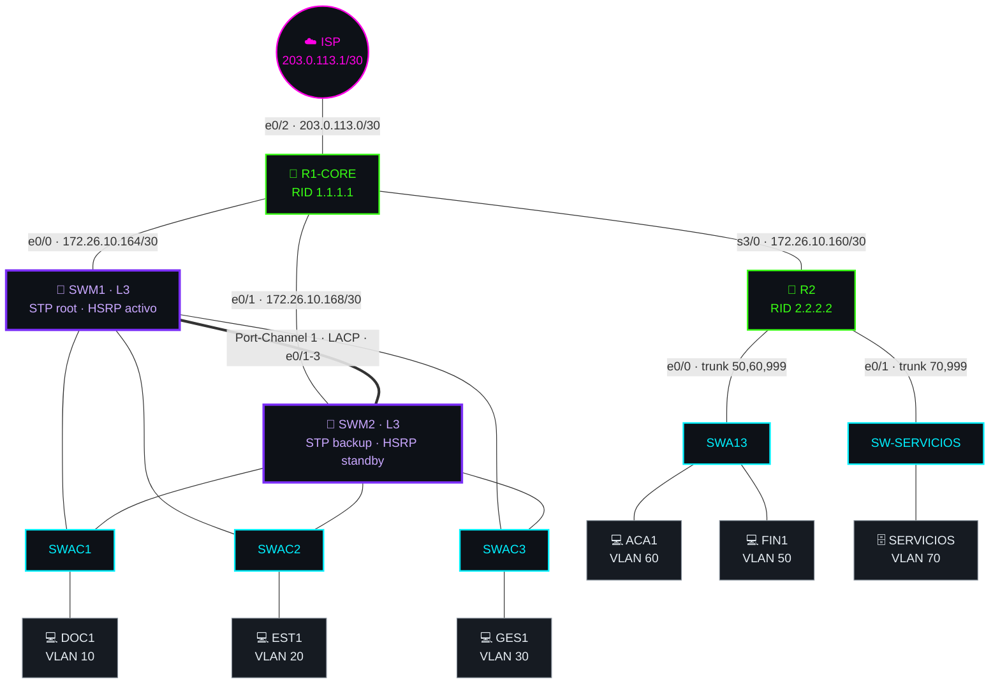
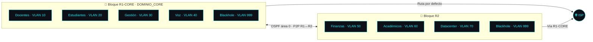

# 🧱 00 · Arquitectura

[⬅️ Volver al README](../README.md)

## Diagrama lógico

## Bloques de la red

## Dispositivos y roles

| 🖥️ Dispositivo | Tipo | Rol |
|---|---|---|
| ISP | Switch L3 | Simula Internet, ruta de retorno `172.26.0.0/16` |
| R1-CORE | Router | Enlaces enrutados a SWM1, SWM2, R2 e ISP; origina ruta por defecto |
| R2 | Router | Subinterfaces 802.1Q y DHCP del bloque R2 |
| SWM1 | Switch L3 | Raíz STP (4096), HSRP activo (110), servidor VTP, DHCP del core |
| SWM2 | Switch L3 | Raíz secundaria (8192), HSRP en espera (100) |
| SWAC1 · SWAC2 · SWAC3 | Acceso | Clientes VTP: DOC1, EST1, GES1 |
| SWA13 | Acceso | Servidor VTP del dominio R2: ACA1, FIN1 |
| SW-SERVICIOS | Acceso | VLAN 70, servidor SERVICIOS |
