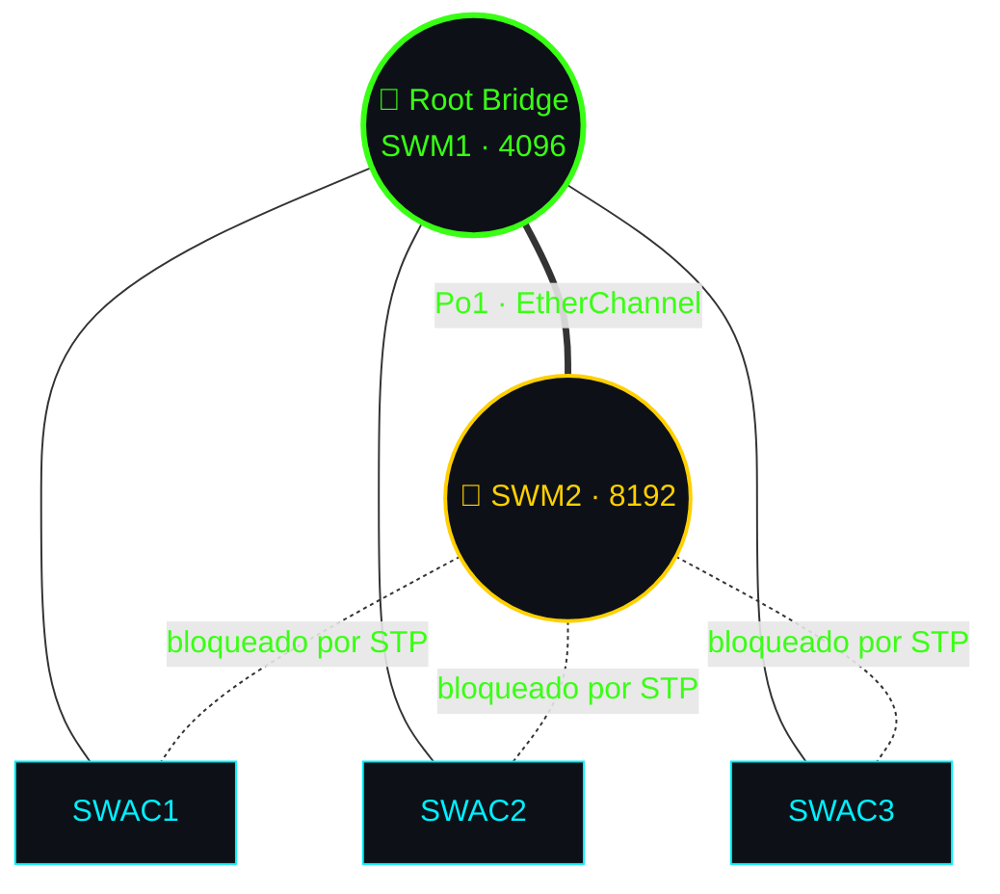

# 🔁 03 · EtherChannel y STP

[⬅️ Volver al README](../README.md)

## EtherChannel (LACP)

Los **3 enlaces** entre SWM1 y SWM2 (`e0/1`, `e0/2`, `e0/3`) forman el **Port-Channel 1** (LACP `active`, modo troncal).

| ✅ Beneficio | Detalle |
|---|---|
| Más ancho de banda | Los 3 enlaces actúan como uno |
| Tolerancia a fallos | Si un cable cae, los demás siguen |
| Compatible con STP | STP lo ve como un solo enlace |

## Spanning Tree (Rapid-PVST+)

| Switch | Prioridad (VLANs 10, 20, 30, 40, 999) | Rol |
|---|:---:|---|
| **SWM1** | `4096` | 👑 Raíz primaria |
| **SWM2** | `8192` | 🥈 Raíz secundaria |
| Acceso | 32768 (defecto) | Nunca serán raíz |

> ⚠️ Diagrama ilustrativo: verifica los puertos bloqueados reales con `show spanning-tree`.

## Protecciones

| Medida | Dónde |
|---|---|
| PortFast | Puertos de acceso |
| BPDU Guard | Puertos de acceso |
| VLAN 999 | Puertos sin uso |

📎 Verificación: [`comandos/verificacion.txt`](../comandos/verificacion.txt)
