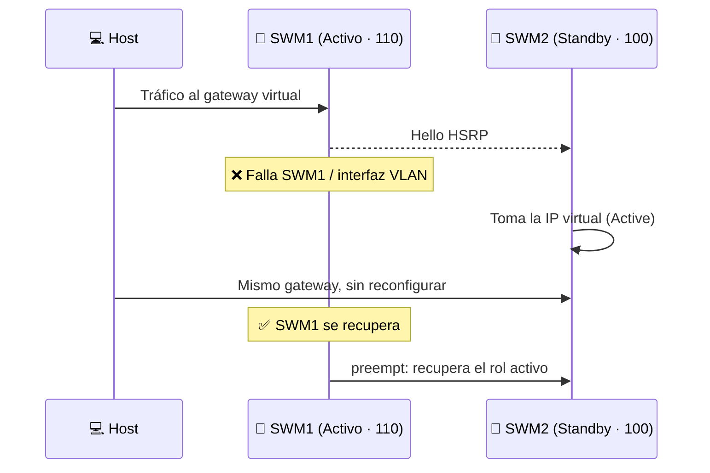

# 🛡️ 04 · HSRP

[⬅️ Volver al README](../README.md)

SWM1 y SWM2 comparten una **IP virtual por VLAN**. El de mayor prioridad es el activo; con `preempt`, el principal recupera el rol al restablecerse.

| VLAN | Red | IP virtual (gateway) | SWM1 | SWM2 | Prioridad SWM1 / SWM2 | Activo |
|:---:|---|---|---|---|:---:|:---:|
| 10 | Docentes | `172.26.8.1` | `172.26.8.2` | `172.26.8.3` | 110 / 100 | SWM1 |
| 20 | Estudiantes | `172.26.0.1` | `172.26.0.2` | `172.26.0.3` | 110 / 100 | SWM1 |
| 30 | Gestión | `172.26.10.65` | `172.26.10.66` | `172.26.10.67` | 110 / 100 | SWM1 |
| 40 | Voz | `172.26.10.97` | `172.26.10.98` | `172.26.10.99` | 110 / 100 | SWM1 |

📎 Pasos de la prueba: [`comandos/pruebas-failover.txt`](../comandos/pruebas-failover.txt)
