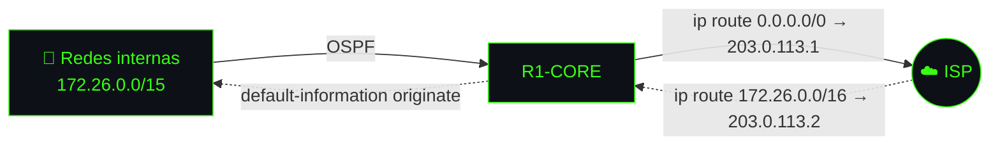

# 🧭 05 · OSPFv2 y salida a Internet

[⬅️ Volver al README](../README.md)

**Proceso OSPF `10` · Área `0`** en R1-CORE, R2, SWM1 y SWM2.

| Router | Router-ID | Redes anunciadas | Notas |
|---|---|---|---|
| **R1-CORE** | `1.1.1.1` | `172.26.10.160/30`, `.164/30`, `.168/30` | `default-information originate` |
| **R2** | `2.2.2.2` | `172.26.9.0/25`, `172.26.9.128/25`, `172.26.10.0/26`, `172.26.10.160/30` | Subinterfaces `passive-interface` |
| **SWM1** | `10.10.10.1` | `172.26.10.164/30` + interfaces VLAN 10, 20, 30, 40 | VLANs `passive-interface` |
| **SWM2** | `10.10.10.2` | `172.26.10.168/30` + interfaces VLAN 10, 20, 30, 40 | VLANs `passive-interface` |

## Salida a Internet

- **R1-CORE:** ruta estática por defecto hacia el ISP, propagada por OSPF.
- **ISP:** ruta de retorno `172.26.0.0/16` hacia R1-CORE.

📎 Scripts: [`configs/R1-CORE.txt`](../configs/R1-CORE.txt) · [`configs/R2.txt`](../configs/R2.txt) · [`configs/ISP.txt`](../configs/ISP.txt)
